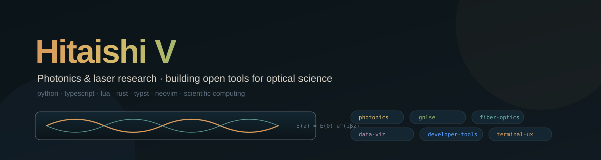

  

  <a href="https://hitaishiv.com">hitaishiv.com</a> &middot;
  <a href="https://hitaishi2222.github.io/photonics_helper/">photonics_helper docs</a> &middot;
  <a href="https://github.com/hitaishi2222?tab=repositories">all repositories</a>

---

I work on **nonlinear fiber and waveguide optics** — ultrafast pulse propagation, pulse
characterization, and the numerics that make experimental results reproducible. The
day-to-day work is a mix of physics modelling and the unglamorous tooling a lab needs:
data exploration, plotting, instrument bookkeeping, and a terminal that behaves.

Everything I build is open source.

## Selected work

| Project | What it does |
|---|---|
| [**photonics_helper**](https://github.com/hitaishi2222/photonics_helper) | Python library for photonics: GNLSE propagation (scalar, vector, multimode), DBR transfer matrices, SHG-FROG trace generation and PCGPA retrieval, Raman models, inverse design. Documented at [hitaishi2222.github.io/photonics_helper](https://hitaishi2222.github.io/photonics_helper/). |
| [**GraphMatrix**](https://github.com/hitaishi2222/GraphMatrix) | Python-first scientific plotting and analysis GUI: typed worksheets, publication-quality figures, a scriptable automation layer. Built as an open alternative to OriginPro. |
| [**imli.nvim**](https://github.com/hitaishi2222/imli-nvim) | A warm ember & coffee colorscheme for Neovim — dark and light variants, Treesitter-first with LSP semantic overrides. |
| [**labs**](https://github.com/hitaishi2222/lab-inventory) | Self-hosted inventory tracker for a research lab: equipment check-out, consumable usage, low-stock alerts, chemical safety records (CAS, GHS, expiry). Docker + Cloudflare Tunnel. |
| [**numpy_visualizer**](https://github.com/hitaishi2222/numpy_visualizer) | Local web dashboard for exploring `.npz` archives — browse named arrays, assign X/Y, and chart them in the browser, no code required. |
| [**herdr-fingers**](https://github.com/hitaishi2222/herdr-fingers) &nbsp;•&nbsp; [**herdr-llama**](https://github.com/hitaishi2222/herdr-llama) | Herdr plugins: pick paths, URLs, IPs and hashes out of the focused pane with vimium-style letter keys; drive `llama-server` as an agent with a live tokens/sec dashboard. |

Smaller tools I keep reaching for: [**gghf**](https://github.com/hitaishi2222/gghf) (Hugging Face → GGUF with provenance), [**h5extra**](https://github.com/hitaishi2222/h5extra) (fzf-style `.h5`/`.hdf5` surgery), [**bro**](https://github.com/hitaishi2222/bro) (Rust CLI for web search from the terminal), [**kinv**](https://github.com/hitaishi2222/kinv) (expiry-first inventory TUI), [**my_cv_typst**](https://github.com/hitaishi2222/my_cv_typst) (typst CV template), [**manim_slides_skill**](https://github.com/hitaishi2222/manim_slides_skill) (skills for authoring Manim presentations).

## Currently

- **Multimode supercontinuum in chalcogenide waveguides** — closing the last gaps between a
  real mode solve (`femwell`/`tidy3d`) and the propagation engine: per-mode effective area and
  γ, multimode Raman, self-steepening with TPA and free carriers, and full-β four-wave mixing
  beyond the degenerate slice.
- **GraphMatrix** — linked brushing between worksheets and graphs, on top of the digitizer,
  command palette and colour-mapped figure types.
- **Herdr plugin ecosystem** — a second pair of plugins for the terminal multiplexer I use
  for everything else.

## Elsewhere

- **Website / CV:** [hitaishiv.com](https://hitaishiv.com)
- **Neovim colorscheme:** [imli.nvim](https://github.com/hitaishi2222/imli-nvim)
- **Open to** research collaborations on ultrafast optics and nonlinear propagation, and to
  contributions on the tools above — issue an issue or write to me.

<!--
Everything here is reproducible: figures in the READMEs come from the code in the same repo,
and the numerical claims in photonics_helper are backed by convergence studies and
analytical checks that run in CI.
-->
